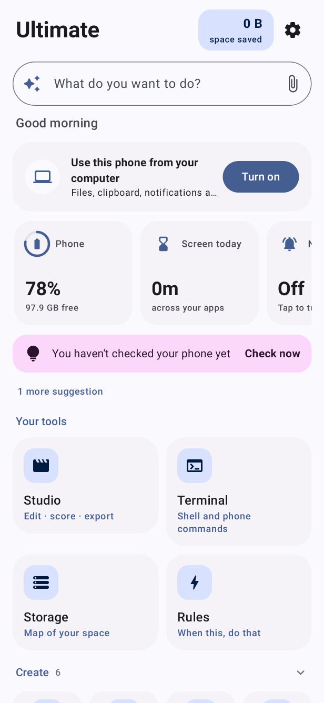
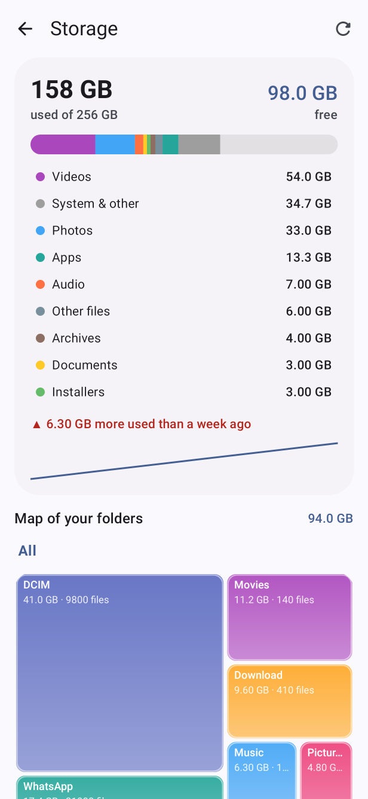
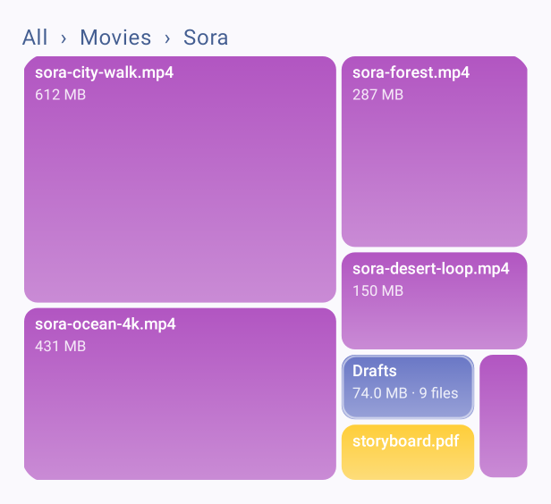
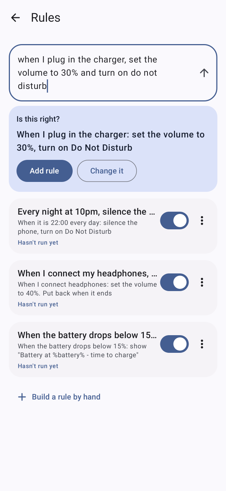
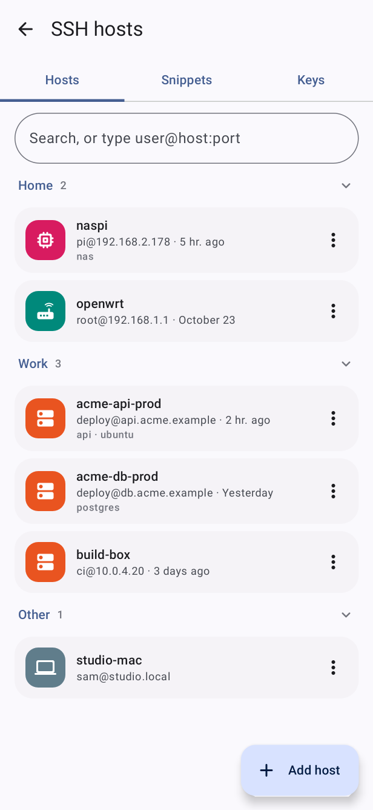
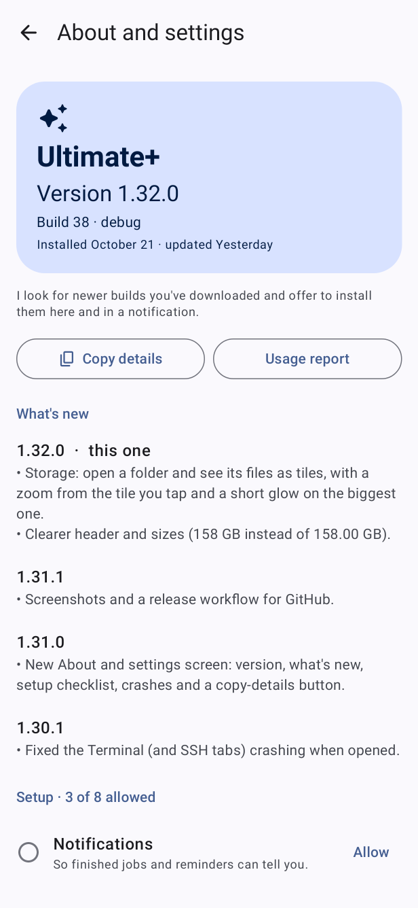

# Ultimate

One Android app that holds a growing set of tools for your own phone: edit and shrink video, see what fills your storage, keep your notification and clipboard history, run rules like "silence at night", open a terminal, and connect to your servers over SSH. No ads, no analytics, no accounts.

<p align="center">
  
  
  
</p>
<p align="center">
  
  
  
</p>

<sub>Screenshots are the app's own screens, rendered on a simulated phone with sample data (not photos of a real device). Home, Storage, inside a folder, Rules, SSH hosts, About and settings. Regenerate them with `gradle -Pscreenshots :app:testUltimateplusDebugUnitTest --tests '*ScreenshotTest'`.</sub>

## Download

Get the latest APKs from the **[Releases page](https://github.com/mosrvs2025/ultimate-android/releases/latest)**. Android 10 or newer.

| File | What it is |
| --- | --- |
| **Ultimate-Plus** | Everything, including the SSH client and server, sending files to your computer, and network tools. Uses the internet permission only for those. |
| **Ultimate** | The same tools with **no internet permission at all**: it cannot send anything anywhere. |
| Studio, Squeeze, Video-to-Audio, Pluck, Traffic-Inspector | Single-purpose apps built from the same code. |

1. Open the APK on your phone and allow installing from your browser when Android asks.
2. Open the app and tap the gear on Home for **About and settings**: your version, what's new, and a checklist of the permissions each tool needs.
3. Updating over an older build keeps your data when both were signed by this project's key. Each release lists that key's SHA-256 and a `SHA256SUMS.txt` to check your download.

APKs are release assets only; they are never committed to git.

## What's inside

- **Create:** Studio (video editor), Squeeze (shrink video), Video to audio, Recorder, Photos, Teleprompter.
- **Phone:** Storage (what fills your phone, by kind, folder, file and app), Clean up (duplicates, similar shots, swipe through photos), Files (browser, bin, APK installer), Notifications (a history that keeps deleted messages), Clipboard history, Checkup, Pluck (extract and inspect apps), Sensors.
- **Network and remote:** SSH hosts (saved servers, keys, snippets, terminal tabs), SSH and SFTP server, send files to a computer from a browser, LAN scan, Traffic inspector.
- **Smart:** Rules (when something happens, do something, and undo it afterwards, also from a plain sentence), Recipes, Screen time, Terminal with phone commands (`battery`, `storage`, `squeeze`, `clip`, ...), a floating orb that opens your tools over any app.

## Privacy

The offline editions have no `INTERNET` permission, so they cannot reach the network. Ultimate+ and Traffic Inspector do, for the features that need it, and only when you turn those on. SSH keys and saved passwords are stored locked with the phone's Keystore, never in the clear. The About screen reads the real permission from the installed app instead of claiming one.

## Publishing a release

Maintainers: a release is built and published by the **Release APKs** workflow (`.github/workflows/release.yml`), which signs every edition with the project's permanent key and attaches the APKs, checksums and the signing certificate fingerprint to a `v<versionName>` release.

1. In **Settings, Secrets and variables, Actions** add `ULTIMATE_KEYSTORE_BASE64` (the keystore, base64-encoded: `base64 -w0 ultimate-release.jks`) and `ULTIMATE_KEYSTORE_PASSWORD`. The key alias is `ultimate`. Keep this key forever: a phone only accepts updates signed by the same key.
2. Bump `versionName` and `versionCode` in `app/build.gradle.kts` and add the notes to `Changelog` in `home/AboutInfo.kt`.
3. Run the workflow from the **Actions** tab. It runs the unit tests, builds, signs and publishes. Running it again for the same version replaces the assets.

The workflow uses `gh` with the built-in `GITHUB_TOKEN`; no third-party actions publish anything.

## Original tools in detail

| Tool | What it does |
| --- | --- |
| **Studio** | Offline video editor: clip timeline, trim/split/reorder, speed, looks, titles, music, manual BPM cuts, saved projects and H.264/AAC export. Included in Ultimate/Ultimate+ and as a standalone edition. |
| **Squeeze** | Shrinks videos with the phone's hardware encoders (HEVC when available), with size targets, a live synced before/after player and measured stats. |
| **Video to audio** | Extracts a video's sound as **MP3** (real LAME encoding), **M4A** (the original AAC, copied untouched) or **WAV**. Trim, mono, bitrate choice, live waveform, in-app player. |
| **Sound meter** | Live microphone levels, energy averages, a level timeline, reference calibration, named sessions, comparisons and CSV export. Foreground-screen capture only; no audio files are recorded. |
| **Pluck** | Lists installed apps, extracts their APKs (split APKs become one `.apks` bundle), and shows details, permissions, signing certificate and an offline ad/tracker SDK scan. |

The **Library** tab lists everything any tool made, filterable by tool. The **Activity** tab shows each tool's current or last run with a live terminal log (codecs chosen, encoder names, real bitrates, speed, files written); the same log appears on every progress screen. Videos shared to Ultimate from other apps go to Squeeze or Video to audio (you choose when both apply).

### Pluck details

- **Clean up:** installed apps that one of our tools replaces get a badge (`✓ Replaced` or `◐ Mostly replaced`), a **Replaced** quick filter, a banner at the top of the list and a **Clean up** screen with a one-by-one uninstall flow and a back-up-first button. A replacement counts only if it is usable: built into this app, or installed as an edition (`app.ultimate`, `app.squeeze`, `app.ultimate.audio`, `app.pluck`). "Mostly" lists what the original does that ours does not, taken from the original's menus and strings, not from running it; **I don't need those** moves an app to ready. Any app can be marked as replaced by hand from its ⋮ menu. To teach it a new app, add an entry to `pluck/model/Replacements.kt`.
- Apps list: seven sorts (reversible), User/System/All, and combinable quick filters (has ads, sideloaded, Play Store, split APK, under 30 MB, disabled). Scanned apps show a tracker badge; every row has a menu (extract, open, app info, copy package, select, uninstall).
- Ad SDK explainers: every SDK is tappable (app detail, report, SDK ranking) and opens a sheet with who makes it, what it is, what it typically collects, why apps include it, and which of your apps contain it. These are general descriptions, not claims about one app's configuration. Each scanned app gets a "Why so many?" story built from mediation detection (AppLovin MAX, AdMob mediation, ironSource LevelPlay): which networks are wired in, whether the app itself calls the mediator or only bundles adapter code, plus the permissions the SDKs can reach (advertising ID, location, phone state). Add an SDK by extending `TrackerScanner.catalog` and `SdkKnowledge.all`; a test fails if one is missing an explanation.
- Ads & trackers report: every scanned app, searchable, sortable, filterable by SDK kind or a single SDK, plus a ranking of SDKs across your apps. Every row opens the app.
- Extract options: **APK** (installs as-is) or **Compact**, a maximum-compression pack for sending, shown with estimated size and checks against 16/25/30/100 MB before anything is written. Modern APKs store code, native libraries and resources uncompressed so apps start fast, so packing typically halves them (measured on four real APKs: 49 to 53% smaller). The APK itself cannot be made smaller and still install as the same app, because its signature covers every byte; unpacking gives back the untouched original. Single apps become `.zip`; split apps become a compressed `.apks` that split installers such as SAI read directly.

## Traffic inspector

Shows which servers chosen apps talk to, live, using a local VPN. The VPN is only Android's `VpnService` API: there is no VPN server and no account. The chosen apps' packets enter a tunnel that ends in this app, which replays each connection over an ordinary protected socket to the real server and wraps the replies back (`traffic/engine/`, a small user-space TCP/UDP stack). Only the apps you select enter the tunnel.

- **Sees:** each connection's server, port, byte counts and timing; site names from DNS and the TLS handshake's server name; unencrypted HTTP requests (flagged); which hosts belong to known ad, analytics and crash-reporting services (`traffic/model/TrafficModel.kt`, a best-effort list, not exhaustive).
- **Cannot see:** what encrypted traffic says. Nothing is decrypted and no certificate is installed. IPv6-only traffic is not captured.
- **Blocking:** domains (or all ad networks) can be refused at the DNS step, plus connections whose handshake names a blocked site. Apps with hard-coded addresses or encrypted DNS can slip past.
- **Code vs network:** with the Pluck scanner present, each app shows which SDKs found in its code were actually contacted this session, answering "present or in use?".
- **Reports:** a session can be saved as CSV to `Downloads/Ultimate` and appears in the Library.
- **Safety:** the relay is covered by JVM tests that drive it with real loopback sockets (handshake, bidirectional data, a 300 KB download under a small window, resets, half-close, DNS, blocking, QUIC refusal). It has not been run against a real phone's tunnel in this repository. Stopping always releases the tunnel.
- **Why separate editions:** a relay must open internet connections, so it needs the `INTERNET` permission, which the offline editions deliberately never request. The inspector ships as **Traffic Inspector** (standalone) and inside **Ultimate+**; plain **Ultimate** stays offline.

## Editions: building a tool as its own app

One codebase builds several apps. `app/build.gradle.kts` defines an edition per product flavor, each with its own app id, name, icon (`src/<edition>/res`) and manifest additions (`src/<edition>/AndroidManifest.xml`, e.g. share targets and the app-listing permission only where needed). `HAS_*` flags switch tools on; they are compile-time constants, so R8 strips every tool an edition does not include.

| Edition | Command | App id |
| --- | --- | --- |
| Ultimate (all tools) | `gradle :app:assembleUltimateRelease` | `app.ultimate` |
| Squeeze | `gradle :app:assembleSqueezeRelease` | `app.squeeze` |
| Ultimate+ (all tools and the inspector; has internet permission) | `gradle :app:assembleUltimateplusRelease` | `app.ultimate.plus` |
| Traffic Inspector | `gradle :app:assembleTrafficRelease` | `app.ultimate.traffic` |
| Video to Audio | `gradle :app:assembleAudioRelease` | `app.ultimate.audio` |
| Pluck | `gradle :app:assemblePluckRelease` | `app.pluck` |
| Studio | `gradle :app:assembleStudioRelease` | `app.ultimate.studio` |

A single-tool edition opens straight into that tool; its top bar links to the Library and Activity. To add an edition, copy a flavor block, set its flags, and add `src/<edition>/` resources.

## Adding a tool

1. Create a package under `app/src/main/java/app/ultimate/<tool>/`.
2. Implement `core/Tool.kt`: an id, title, icon, a Compose `Screen`, a `library` flow of `LibraryItem`s, and how to remove one.
3. If it does long work, make its manager a `core/WorkSource` and register it in `UltimateApp.onCreate`. One foreground service and notification covers every tool, with a cancel action per tool.
4. Add the tool to `UltimateApp.tools` behind a new `HAS_<TOOL>` flag. Home, the Library, the Activity tab and share routing pick it up with no other changes.
5. Give the manager a `JobLog` and write to it at each decision point; the terminal panels show it.

Shared building blocks live in `core/`: formatting, theme, `JsonFile` (atomic storage), `Waveform`, `AudioPlayerBar`, `VideoThumb`, `AppIcon`, `SuccessCheck`, `rememberNotificationConsent`.

## Notes and limits

- **MP3 encoding** uses [jump3r](https://git.iem.at/sciss/jump3r), a pure-Java port of LAME 3.98 (LGPL 2.1+), pulled in unmodified as a Maven dependency. Android has no `javax.sound`, so `app/src/main/java/javax/sound/sampled/AudioFormat.java` is a minimal stand-in covering only the members the encoder uses. The encoder was verified on a JVM with `javax.sound` removed, producing valid MP3 that `ffprobe` reads back at the requested bitrate. Encoding on a phone has not been tested.
- **QUERY_ALL_PACKAGES** is needed to list every app on Android 11+. It is restricted by Google Play policy, so this app is intended for sideloading.
- **Save locations:** videos in `Movies/Squeeze`, audio in `Music/Ultimate`, APKs in `Downloads/Pluck`.
- Not tested on a physical device in this repository.

## Build

Requirements: JDK 17+, Gradle 8.9+, Android SDK with platform 35 and build-tools 35.

```sh
export ANDROID_HOME=/path/to/android-sdk
gradle :app:testUltimateDebugUnitTest
gradle :app:assembleRelease    # every edition: app/build/outputs/apk/<edition>/release/
```

The release build is signed with the debug key for sideloading. Configure your own keystore before distributing.

## Sound meter

Available in the Ultimate edition only. Microphone permission is requested after tapping Start; the other editions do not declare it. Capture stops on navigation or when the app leaves the foreground, and the session is saved to the shared Library. No microphone foreground service or background recording is used.

Uncalibrated values are **dBFS** (digital microphone levels), with a −120 dBFS display floor. A manually supplied reference offset enables an explicitly labeled **estimated SPL** view. It is unweighted, not dBA, and not a certified sound-level meter. Match calibration to the actual microphone route; Android processing and clipping affect readings. Calibration is stored locally. Samples are processed in memory; saved sessions contain interval levels, clipping counts, calibration metadata and the input route, never audio.

The timeline retains the latest 120 roughly one-second intervals; full session intervals remain in the saved session and CSV. The elapsed counter measures captured samples, not wall-clock gaps. The session records why capture ended. Energy averages weight actual sample counts. Min/max refer to captured read-block RMS levels; sample peak is a digital sample peak. No fabricated random or history-dependent boosts are applied. Sessions can be renamed, compared, deleted and exported using Android's document picker. Exported CSV includes digital levels and separate calibration/estimated-SPL columns.

Sound-meter unit tests cover silence, a sine wave, amplitude doubling, uneven reads, clipping, partial buffers and determinism. Physical-device accuracy and interruption/lifecycle testing remain required before relying on readings.

## Studio

Build standalone with `gradle :app:assembleStudioRelease`; build the toolbox with `gradle :app:assembleUltimateRelease`. Studio uses the Android document picker and retained read grants, so it does not need broad media-library permissions. Standalone Studio and Ultimate remain offline. Ultimate+ retains the traffic inspector's internet permission; Studio itself does not make network requests.

Add videos, select a clip, trim/split or reorder it, then choose Looks, Titles or Music. Saved drafts reopen from Projects. The music track loops to the film length; BPM is entered manually. Split clips to time different lyric/title cards. Canvas choices are portrait, landscape and square; exports offer 720 or 1080 short-side resolution with H.264/AAC MP4 and no added watermark. Output goes to Movies/Ultimate Studio and the shared Library, with progress and cancellation in Activity.

Drafts reference original files rather than bundling them. Deleting/moving originals or revoking document access can prevent reopening/exporting; failures are shown rather than silently dropping clips. Preview may have brief boundary gaps; the exported composition is continuous. HDR exports are tone-mapped to SDR. Phone-specific codec/GPU behavior still requires device testing. This build does not include automatic captions, AI generation, multi-video overlays, keyframes or transitions.

See [`docs/app-investigations/capcut-19.4.0.md`](docs/app-investigations/capcut-19.4.0.md) for artifact evidence, independent implementation choices and the next useful inputs.


## Repository migration

Imported from `mosrvs2025/rea`, branch `claude/android-app-redesign-nrs3yt`, commit `881c510`. The original history and investigation evidence remain in REA. Use this repository for future Ultimate feature branches; bring any later Ultimate changes from REA here before merging concurrent work. No REA source was deleted.

Build from the root with JDK 17, Gradle 8.9 and Android SDK 35. `main` is the working base for this standalone project. Start future Ultimate feature branches here; use REA only for separate reverse-engineering work.

GitHub secrets do not move between repositories. Before publishing updates, configure the existing permanent signing key here; a locally debug-signed build cannot update an APK signed with the previous release key. The companion release workflow is available here as a manual workflow; configure the COMPANION signing secrets before running it.

The migration also includes Claude's terminal and floating-orb changes through REA commit `9f2c077b9a763a27ff9a79054d4696d749bee1bc`, reconciled with the SSH foreground-service manifest entry. Continue Ultimate development in this repository.
